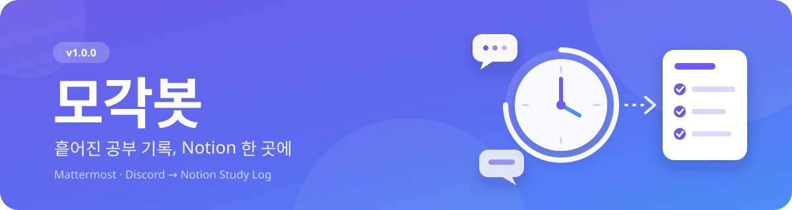
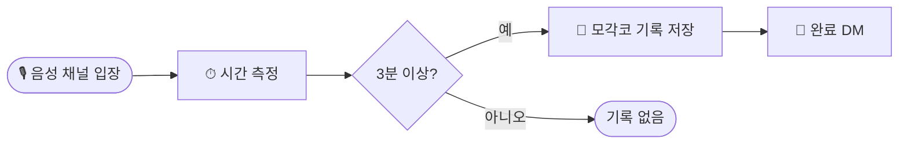

<div align="center">



<br>

**Mattermost**와 **Discord**의 공부 기록을 **Notion Study Log**로 모아주는 봇

<br>


<br>

[✨ 기능](#-주요-기능) · [👀 미리보기](#-미리보기) · [📝 사용법](#-사용법) · [🛠 기술 스택](#-기술-스택) · [❓ FAQ](#-faq)

</div>

<br>

---

## ✨ 주요 기능

<table>
  <tr>
    <td width="50%" valign="top">
      <h3>⌨️ 수동 기록 등록</h3>
      Mattermost와 Discord에서 <b>날짜 · 시간 · 공부 내용</b>을 입력해 바로 저장해요.
    </td>
    <td width="50%" valign="top">
      <h3>🎧 음성 자동 기록</h3>
      Discord 음성 채널에 <b>3분 이상</b> 머문 뒤 퇴장하면 <code>모각코</code> 기록이 자동으로 저장돼요.
    </td>
  </tr>
  <tr>
    <td width="50%" valign="top">
      <h3>🔗 계정 연결 · 중복 검사</h3>
      연결된 멤버 이름으로 기록하고, 같은 멤버의 <b>겹치는 공부 시간</b>은 등록을 막아요.
    </td>
    <td width="50%" valign="top">
      <h3>📒 기록 확인</h3>
      저장 결과를 본인에게만 안내하고, 링크 한 번으로 <b>Notion Study Log</b>를 열 수 있어요.
    </td>
  </tr>
</table>

<br>

## 👀 미리보기

Discord에서는 **카드 + 기록 확인 버튼**, Mattermost에서는 **텍스트 + 링크**로 결과를 안내해요.
음성 자동 기록 결과는 **개인 DM**으로 전달돼요.

> ### ✅ 공부 기록 완료
>
> 홍길동님의 공부 기록을 저장했습니다.
>
> **🕒 공부 시간**<br>
> 2026-10-13 19:00 ~ 20:30 · 90분
>
> **📝 공부 내용**<br>
> Java 복습

`📒 Study Log 보기` 버튼을 누르면 전체 공부 기록을 확인할 수 있어요.

<br>

## 🚀 시작하기

> [!TIP]
> 처음 이용할 때는 **관리자에게 계정 연결**을 요청해주세요.
> 연결된 이름으로 기록되기 때문에 이름을 매번 입력하지 않아도 돼요.

<br>

## 📝 사용법

### ⌨️ 수동 기록 등록

```text
# 같은 날
/st 1013 1900 2030 Java 복습

# 자정을 넘긴 경우
/st 1013 2300 1014 0100 Java 복습
```

| 플랫폼 | 입력 방법 |
|:---:|---|
|  | 위 예시를 **그대로 입력**해요. |
|  | `/st`를 선택하고 **`입력` 옵션**에 날짜 · 시간 · 공부 내용을 넣어요. |

> [!IMPORTANT]
> Discord에서는 `입력:`이라는 글자를 직접 적지 않아요.

#### 📐 입력 규칙

| 항목 | 형식 · 범위 |
|:---:|---|
| 📅 날짜 | `MMDD` |
| ⏰ 시각 | `HHmm` |
| 🌏 기준 | **2026년 · 한국 시간** |
| ⏳ 길이 | **1분 ~ 24시간** |
| 🌙 자정 넘김 | 종료 날짜도 함께 입력 |

<br>

### 🎧 음성 자동 기록

Discord 계정을 연결한 뒤 일반 음성 채널에 참여하면 측정이 시작돼요.



<br>

### 🧭 도움말 · 계정 확인

| 기능 | 명령어 |
|:---:|:---:|
| 📖 도움말 | `/st` 또는 `/st 도움말` |
| 🪪 연결된 계정 확인 | `/st 내정보` |

> Discord에서는 `도움말`과 `내정보`도 `/st`의 `입력` 옵션에 넣어주세요.

<br>

## 🛠 기술 스택


<br>

## ❓ FAQ

> 각 질문을 눌러 **해결 방법**을 펼쳐보세요 👇

<details>
<summary><b>🔍 명령어가 없다고 나와요</b></summary>
<br>

1. **15반 채널**로 이동해주세요. 16기 전체 서버에서는 명령어를 사용할 수 없어요.
2. 이미 15반 채널이라면 **Ctrl + Shift + R**을 눌러 새로고침한 뒤 다시 입력해주세요.

</details>

<details>
<summary><b>🔗 계정이 연결되지 않았다고 나와요</b></summary>
<br>

`/st 내정보`로 사용자 ID를 확인한 뒤, 관리자에게 **사용자 ID와 Members에 등록된 이름**을 전달해주세요.

</details>

<details>
<summary><b>⏳ 처리 중인데 완료 응답이 오지 않아요</b></summary>
<br>

1~2분 뒤 **Study Log에서 본인 기록을 확인**해주세요. 응답이 오지 않아도 기록은 저장됐을 수 있어요.

> [!WARNING]
> 확인하기 전에 같은 기록을 다시 입력하지 말아주세요.
> 기록이 없고 처리가 계속 지연되면 관리자에게 문의해주세요.

</details>

<details>
<summary><b>⚠️ 공부 시간이 겹친다고 나와요</b></summary>
<br>

Study Log에서 기존 기록의 시간을 확인하고, **겹치지 않는 시간**으로 수정해주세요.
Mattermost와 Discord로 등록한 기록 모두 함께 검사해요.

</details>

<details>
<summary><b>📅 날짜나 시간 입력이 잘못됐다고 나와요</b></summary>
<br>

날짜는 **MMDD**, 시각은 **HHmm** 형식으로 입력해주세요. 자정을 넘겼다면 종료 날짜도 적어주세요.

미래 시간은 등록할 수 없으며, 공부 시간은 1분~24시간이어야 해요.

</details>

<details>
<summary><b>🚦 이전 기록 처리 중이거나 요청이 많다고 나와요</b></summary>
<br>

이전 기록 처리 중이라면 완료된 뒤 다시 입력해주세요. 요청이 많다는 안내가 나오면 잠시 기다린 뒤 다시 시도해주세요.

이 안내가 나온 요청은 **새로 접수되지 않아요.**

</details>

<details>
<summary><b>💌 Discord 음성 기록의 완료 DM이 오지 않아요</b></summary>
<br>

연결된 Discord 계정으로 **일반 음성 채널에 3분 이상 참여한 뒤 퇴장**했는지 확인해주세요.

먼저 Study Log에서 저장 여부를 확인하고, Discord의 해당 서버 개인정보 설정에서 **서버 멤버의 DM을 허용**해주세요.
DM을 받지 못해도 기록은 저장됐을 수 있어요.

</details>

<br>

<div align="center">

**모각봇 v1.0.0** · Made with ☕ for 꾸준한 공부 습관

</div>
